# Two-Agent Parallel Roadmap

A split of the remaining [`ROADMAP.md`](ROADMAP.md) work into two tracks that can
run concurrently with minimal collision. The split follows a real architectural
seam, not an arbitrary halving: **Track A owns the headless deterministic
engine; Track B owns the interactive surface.**

Why this seam:

- **Disjoint file sets.** Neither track edits the other's crates. See the
  ownership table below — it is the conflict-avoidance mechanism.
- **Different verification models.** Track A is fully provable by
  `cargo test --workspace` in CI. Track B needs a display and human eyes. Mixing
  them in one agent means the testable work is held hostage to the untestable.
- **Asymmetric maturity.** Track A extends 2,900 lines of working code. Track B
  is close to greenfield (23 lines total across `aadt-render` + `aadt-app`), so
  it can move fast without destabilizing the proven pipeline.
- **Preserves the core principle.** The deterministic core stays reproducible
  and auditable independent of the GUI and of AI availability (spec §8).

---

## Crate ownership

Ownership is exclusive. An agent that needs a change in the other's crate
**files a request rather than editing it** (see Interface contract).

| Crate | Owner | Notes |
|---|---|---|
| `aadt-geometry` | **A** | Kernel. Additive only; Track B depends on its stability. |
| `aadt-model` | **A** | Entity store, transactions. Shared vocabulary — see contract. |
| `aadt-dxf` | **A** | Import/export, entity-type coverage. |
| `aadt-detect` | **A** | Detection, classification, wall graph. |
| `aadt-takeoff` | **A** | Quantities, cost codes, exports. |
| `aadt-ai` | **A** | Orchestration, model lifecycle. |
| `aadt-render` | **B** | wgpu 2D canvas. |
| `aadt-app` | **B** | Desktop shell, interactive prompt. |
| `aadt-command` | **B** | Interactive command set, tab-completion. |
| `aadt-cli` | **shared** | **A** owns `takeoff`/`run` + `tests/golden.rs`; **B** owns interactive entry. Touch only your half. |
| `aadt-docs`, `aadt-lisp`, `aadt-pdf` | — | M5–M7. Untouched by both tracks. |

---

## Track A — Deterministic Engine

*Continues the current session's work. Verifiable headlessly; every item ships
with tests.*

### A1. Room merge/dedup policy (M2, remaining)
Explicit closed polylines and `WallGraph::faces` can describe the same room.
Define and implement a deterministic precedence rule, so a plan with both
sources does not double-count area. **This is a correctness bug in waiting** —
it silently inflates takeoff quantities, which is the product's core output.
- Ship: dedup by centroid containment + area tolerance; explicit polyline wins.
- Verify: fixture with overlapping explicit + derived rooms; assert single count.

### A2. DXF entity coverage (M1, remaining — *unblocks Track B*)
Arcs, circles, text, hatch, blocks, dimensions on import and export.
**Prioritized first** because Track B cannot render what the model cannot hold.
- Ship: entity types + round-trip tests per type.
- Verify: extend `round_trip_preserves_entities`.

### A3. `.xlsx` export + schedule tables (M3, remaining)
True `.xlsx` (not CSV-renamed) and in-drawing schedule tables.
- Ship: minimal OOXML writer or a vetted crate; keep the CSV path untouched.
- Verify: golden-style test on the archive's sheet XML.

### A4. AI model lifecycle (M4, remaining)
Subprocess spawn, warm-idle, auto-unload for `OllamaClient` (spec §6.1).
- Ship: lifecycle behind the existing `ModelClient` trait; no background work.
- Verify: mockable lifecycle states; graceful degradation stays intact.

### A5. Anomaly flagging (M4, remaining)
Flag geometry the detector finds suspect (unclosed loops, implausible
thicknesses, orphan openings) as structured advisory output.
- Verify: deterministic — no model call required to produce flags.

---

## Track B — Interactive Surface

*For the second agent. Greenfield; verified interactively plus unit tests where
possible.*

### B1. wgpu 2D canvas (M1, remaining)
Target 60fps at 100k+ entities (spec §4.3). Pan/zoom, layer colors, grid.
- Ship: `aadt-render` draws a read-only `Document` snapshot.
- Verify: a synthetic 100k-entity benchmark reporting frame time.

### B2. App shell (M1, remaining)
`aadt-app` window hosting the canvas + a command prompt, wired to the existing
`aadt-command` registry. **The command line is the primary interface** (spec:
command-first, always) — the canvas is a viewport, not a toolbar-driven editor.

### B3. Interactive command set (M1, remaining) — *in progress*
The curated ~60–80 draw/modify/annotate/organize commands, registered through
the existing registry so every one is scriptable and undoable.
- Verify: each command exercised headlessly via `aadt run <script>`.
- ✅ First batch landed in `aadt-command`: draw `CIRCLE`/`ARC`/`RECTANG`/`PLINE`,
  annotate `TEXT`, modify `COPY`/`MOVE` (plus the existing `LINE`/`LAYER`/`ERASE`
  /`UNDO`/`REDO`/`LIST`), all with aliases and undoable via `Document::transact`.
  Tested by script and covered end-to-end by `aadt run`.
- Follow-ups: `OFFSET`/`MIRROR`/`ROTATE`/`SCALE` need an in-place geometry-update
  API on `Document` (currently `MOVE` reassigns the entity id via remove+add) —
  **request to Track A** for an additive `Document::update_geometry(id, geom)`.

### B4. Tab-completion (M1, remaining)
Completion over command names and aliases in the interactive prompt.

### B5. Live takeoff panel (M3 integration)
Surface the existing `LiveTakeoff` in the UI. It already recomputes on
revision change — **consume it, do not reimplement it.**

---

## Interface contract

The tracks meet at exactly two places. Keep them narrow.

1. **`aadt-model` is the shared vocabulary.** Track A owns it. Track B consumes
   it **read-only** for rendering and mutates it **only** through
   `Document::transact` and registered commands — never by reaching into the
   entity store. This keeps undo/redo atomic (§4.1).
2. **Track B needs an entity type that does not exist yet.** Do not add it to
   `aadt-model` or `aadt-dxf`. File it as a request to Track A (item A2 covers
   the known set). Unilateral edits to engine crates are how the two tracks
   start conflicting.

Track A's guarantee to Track B: **additive changes only.** No breaking signature
changes to `Document`, `Detection`, or `Takeoff` without flagging first.

---

## Shared-file protocol

These four files are the only realistic conflict sites. Rules:

| File | Rule |
|---|---|
| `Cargo.lock` | **Never hand-merge.** On conflict: `git checkout --theirs Cargo.lock && cargo check` to regenerate. |
| Workspace `Cargo.toml` | Add deps under your own crate. Shared `[workspace.dependencies]` edits: announce before pushing. |
| `README.md` | Track A owns the pipeline/build sections; Track B owns the app/UI sections. |
| `ROADMAP.md` | Update only your own track's status lines. |
| `.github/workflows/ci.yml` | Track A owns. |

**Branching.** Neither track commits to `main`. Use `track-a/<item>` and
`track-b/<item>`, one PR per roadmap item, and **rebase on `main` rather than
merging** so history stays linear and conflicts surface early. Small PRs beat
big ones here — a week-long Track B branch touching the shell will drift.

**Green bar.** `cargo fmt --check`, `cargo clippy -D warnings`, and
`cargo test --workspace` must pass before every push. Both tracks share CI.

---

## Sequencing

```mermaid
gantt
    title Two-track sequencing
    dateFormat X
    axisFormat %s
    section Track A (engine)
    A2 DXF entity coverage (unblocks B)   :a2, 0, 2
    A1 Room merge/dedup                   :a1, 2, 2
    A3 xlsx + schedules                   :a3, 4, 3
    A4 AI lifecycle                       :a4, 7, 2
    A5 Anomaly flagging                   :a5, 9, 2
    section Track B (surface)
    B1 wgpu canvas (stub entities)        :b1, 0, 3
    B2 App shell                          :b2, 3, 2
    B3 Interactive commands               :b3, 5, 4
    B4 Tab-completion                     :b4, 9, 1
    B5 Live takeoff panel                 :b5, 10, 2
```

**The one real dependency is A2 → B1.** Track A ships entity coverage first;
Track B builds the canvas against the entity types that already exist (lines,
polylines, circles, inserts) and extends as A2 lands. Everything else is
genuinely independent.

**Integration checkpoints:** after A2/B1 (canvas renders the full fixture), and
after A3/B5 (live quantities visible in the shell). Rebase both tracks on `main`
at each checkpoint.
