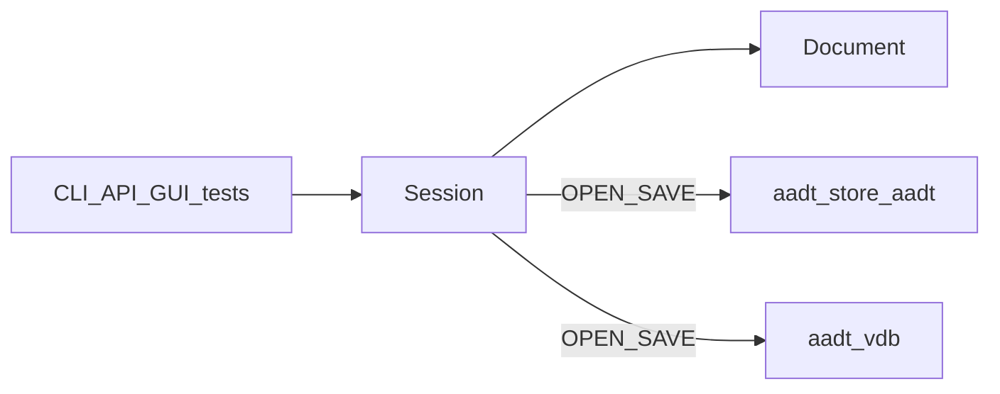

# Volume 1 — CAD Architecture Overview

Internal engineering handbook. See [STATUS.md](./STATUS.md) for plan vs existing.

## Architectural goals

1. **Deterministic CAD spine** — same input → same `Document` / detect / plot output.
2. **One write path** — every mutation is a command line through `Session::feed`
   (CLI, GUI, API, tests).
3. **Curated command band** — AutoCAD-like interaction, not AutoCAD command count
   ([ROADMAP](../ROADMAP.md)).
4. **Capabilities as layers** — detect, standards, Assist, takeoff sit *on* the
   core; they do not fork a second document API.
5. **Local-first persistence** — `.aadt` (SQLite + history) and `.vdb` (ShilpiDB)
   are files; collaboration is not required to draft.

## Current implementation

### Layer diagram

```
┌───────────────────────────────────────────────────────────────┐
│                 aadt-app / aadt-cli / aadt-api                │
├───────────────────────────────────────────────────────────────┤
│  Intelligence: aadt-object · graph · embed · vecdb · assist   │
│                aadt-takeoff                                   │
├───────────────────────────────────────────────────────────────┤
│  Capabilities: aadt-detect · docs · standards · pdf · library │
├───────────────────────────────────────────────────────────────┤
│  CAD core: aadt-command · geometry · lisp · model             │
├───────────────────────────────────────────────────────────────┤
│  I/O: aadt-dxf · aadt-store (.aadt) · aadt-vdb (.vdb)         │
│  Render: aadt-render                                          │
└───────────────────────────────────────────────────────────────┘
```

Authoritative crate map: [architecture/overview.md](../architecture/overview.md).

### Live source of truth

| Concern | Owner |
|---------|--------|
| Interactive geometry | `aadt_model::Document` inside `Session` / `Context` |
| Undo stack | In-memory on `Document` |
| File checkpoints | `aadt-store` HISTORY on `.aadt` |
| Vector / spatial file | `aadt-vdb` / ShilpiDB `.vdb` |
| Selection (headless) | `Context::selection` |
| Selection (GUI) | `AadtApp::selection` synced into feed when needed |



### Drivers

| Driver | Entry | Notes |
|--------|-------|-------|
| CLI | `aadt` shell / `run` scripts | Registers I/O + Assist on `Registry` |
| GUI | `AadtApp::app_feed` | Interactive `Tool` → feed |
| API | `POST /v1/command` | ADR-0015; no entity POST |
| Tests | `Session::feed` directly | Headless preferred |

## Target / planned

[aadt-shilpidb-architecture.md](../architecture/aadt-shilpidb-architecture.md)
describes **ShilpiDB as SoT**, entity GUIDs, transactional SpatialGrid on every
edit, and “no monolithic drawing object.” ROADMAP M10–M14 extend objects, graph,
embeddings, Assist, takeoff, and local API.

## Gap analysis (plan vs existing)

| Claim (target docs) | Reality |
|---------------------|---------|
| ShilpiDB is SoT | SoT while drafting is RAM `Document`; DB files are persistence formats |
| SpatialGrid on every pick | Grid exists in `.vdb`; GUI pick/osnap are linear scans |
| Entity GUID + audit on every entity | Model uses `EntityId`; richer audit is Assist / store / vdb layers |
| Zero dual write paths | **Held** — API and GUI both use command lines |

## Data structures (spine)

| Type | Crate | Role |
|------|-------|------|
| `Session` | `aadt-app` | Owns interpreter, context, transcript, optional LISP |
| `Context` | `aadt-command` | `doc`, selection, groups, clipboard, `nav_hint`, … |
| `Document` | `aadt-model` | Entities, layers, blocks, floors/spaces, undo |
| `Entity` / `Geometry` | `aadt-model` | Drawable content |
| `Floor` / `ModelSpace` | `aadt-model` | ADR-0009 storeys × categories |

## Module layout (app shell)

```
crates/aadt-app/src/
  lib.rs              Session::feed
  gui.rs              Tool, paint, dyn input, transparent cmds
  command_engine.rs   interactive FSM + CATALOG
  osnap.rs            snaps
  selection.rs        region select
  gui_chrome.rs       docks
  gui_theme.rs        AAD Chrome tokens
```

## Error handling

- Commands return `Result<String, String>`; `Session` wraps as `Feedback::Ok|Err|Silent`.
- Errors are **values** for the transcript — not panics (except debug nested `transact`).

## Performance considerations

- Drawlist rebuild gated on `Document::revision` ([overview](../architecture/overview.md)).
- Viewport repaint gated on meaningful motion / drafting.
- Spatial acceleration for pick is still a Vol 13 gap.

## Unit and integration testing

- Prefer headless `Session::feed` over GUI.
- GUI shell is explicitly not headless-verifiable ([gui.rs](../../crates/aadt-app/src/gui.rs) module docs).

## Future extension points

1. Keep registering new commands on `Registry` (CLI pack or `aadt-command` pack).
2. Do **not** add `POST /v1/entities` — violates ADR-0015.
3. When SpatialGrid is wired into GUI, keep `feed` as the mutation boundary.
4. Deepen Vol 5 when entity GUID migration is scheduled.

## Related volumes

[Vol 2 Command Engine](./vol-02-command-engine.md) · [Vol 5 Entity DB](./vol-05-entity-database.md) ·
[Vol 12 Plugin/API](./vol-12-plugin-api.md)
