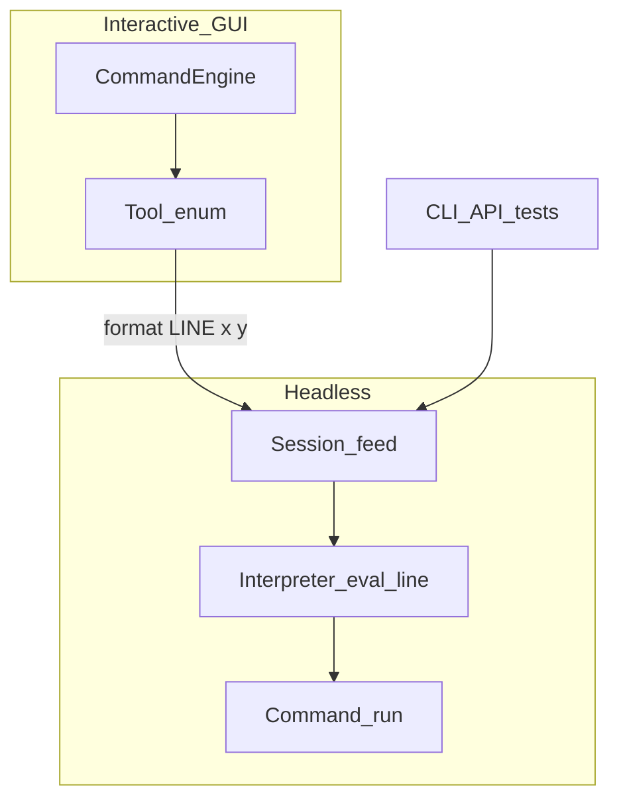
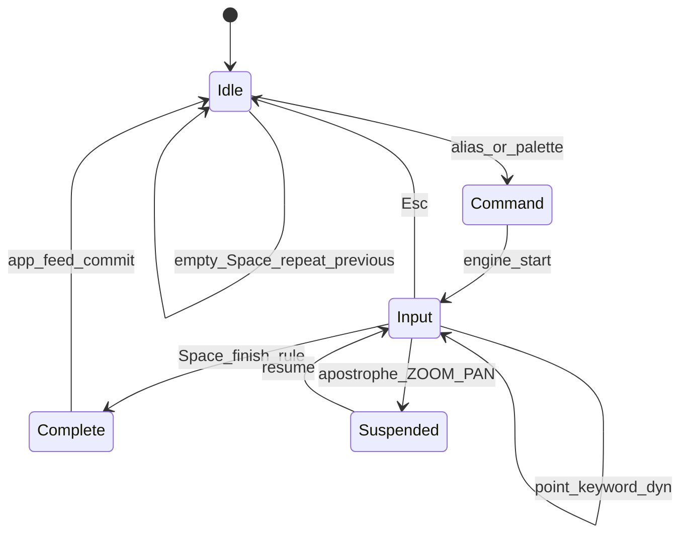
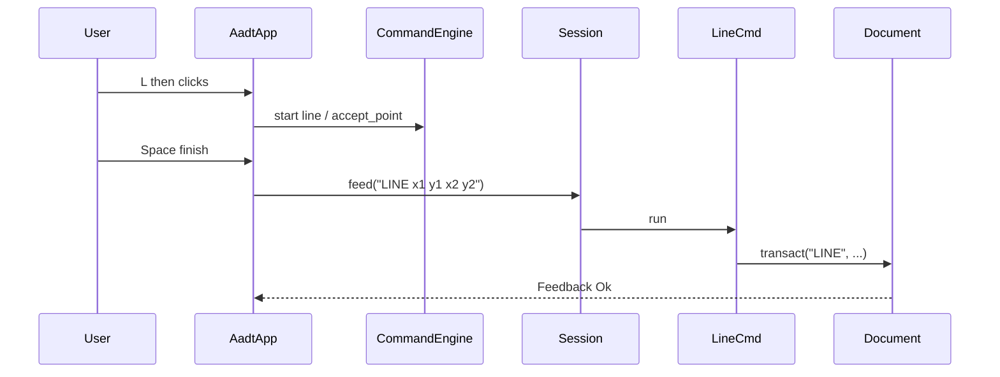

# Volume 2 — Command Engine

Internal engineering handbook. UX step tables live in
[command-workflows.md](../ux/command-workflows.md) — this volume covers **machinery**.

## Architectural goals

1. Headless commands are fully specified on one line (scriptable, testable).
2. Interactive drafting uses a small Spacebar FSM that **emits** those lines.
3. Extensions register on one `Registry` without forking a second interpreter.
4. Transparent view commands never mutate geometry mid-edit without suspend/resume.
5. Curated interactive catalog; depth via LISP and registered Assist packs.

## Current implementation

### Two layers

| Layer | Location | Role |
|-------|----------|------|
| Headless interpreter | `crates/aadt-command` | `Interpreter::eval_line` → `Command::run` |
| Interactive engine | `crates/aadt-app/src/command_engine.rs` | `EngineState` + `CATALOG` of `CommandDef` |
| Tool state | `crates/aadt-app/src/gui.rs` | `Tool` enum accumulates picks |



### `Session::feed` call chain

File: [`crates/aadt-app/src/lib.rs`](../../crates/aadt-app/src/lib.rs)

```
Session::feed(line)
  ├─ try_feed_lisp(trimmed)
  │    bare "(…)" | LISP | LISPLOAD
  └─ Interpreter::eval_line(&mut ctx, line)
       ├─ strip BOM, trim; blank/#/; → Ok(None) → Feedback::Silent
       ├─ split_whitespace → (name, args)
       ├─ Registry::resolve(name)
       ├─ ctx.history.push(line)
       └─ command.run(ctx, args)
```

### Traits and core types

From [`aadt-command/src/lib.rs`](../../crates/aadt-command/src/lib.rs):

```rust
pub trait Command {
    fn name(&self) -> &str;
    fn aliases(&self) -> &'static [&'static str] { &[] }
    fn help(&self) -> &str { "" }
    fn run(&self, ctx: &mut Context, args: &[String]) -> Result<String, String>;
}

pub struct Context {
    pub doc: Document,
    pub history: Vec<String>,
    pub selection: Vec<EntityId>,
    pub prev_selection: Vec<EntityId>,
    pub groups: HashMap<String, Vec<EntityId>>,
    pub layer_iso_snapshot: Option<Vec<(String, bool, bool)>>,
    pub clipboard: Vec<Entity>,
    pub nav_hint: Option<String>,
    pub room: room::RoomSettings,
    pub drawing_path: Option<String>,
}

pub struct Registry { /* name/alias → command index */ }

impl Registry {
    pub fn register(&mut self, command: Box<dyn Command>);
    pub fn resolve(&self, token: &str) -> Option<&dyn Command>;
}
```

`Interpreter::eval_line` returns `Result<Option<String>, String>` — `Ok(None)` is
silent success (blank / comment).

### Interactive catalog

From [`command_engine.rs`](../../crates/aadt-app/src/command_engine.rs):

```rust
pub enum EngineState {
    Idle,
    Command { id: CommandId },
    Input { id: CommandId, step: usize },
    Complete { id: CommandId },
}

pub struct CommandDef {
    pub id: CommandId,
    pub aliases: &'static [&'static str],
    pub steps: &'static [StepKind],
    pub repeatable: bool,
    pub finish: FinishRule,
    pub tool_token: &'static str,
}
```

Bridge: `start_command_id` → `engine.start(id)` → `tool_for(tool_token, has_sel)` →
on finish, assemble `"LINE …"` → `app_feed`.

### Transparent commands

**Not in `aadt-command`.** GUI path in `gui.rs`:

- Apostrophe prefix (`'ZOOM`, `'PAN`) → `dispatch_transparent`
- `suspend_for_transparent` saves `Tool` + engine state
- View command runs (camera / `nav_hint`)
- Resume on finish / Esc policy

Headless `ZOOM` / `PAN` only set `Context::nav_hint` — no mid-command suspend.

### Command families (registry packs)

| Family | Module / registrar | Examples |
|--------|-------------------|----------|
| Draw / modify / dim / undo | `aadt-command/src/lib.rs` `builtins` | LINE, MOVE, TRIM, DIM, UNDO |
| Essentials + stubs | `essentials.rs` | POLYGON, LAYISO, XREF (stub) |
| Floors / spaces | `floors.rs` | FLOOR, CATEGORY, CHSPACE |
| Annotation | `annotation.rs` | TABLE, CALLOUT, REVCLOUD |
| Autodim | `autodim.rs` | QDIM, AUTODIM |
| Blocks | `blocks.rs` | BPARAM, BVIS |
| Room / imperial | `room.rs` | IROOM, IAR |
| Firm suites | `hcw.rs`, `bplt.rs`, `texttools.rs` | HCW*, BPLT*, FIXTXT |
| I/O + Assist | `aadt-cli/src/commands.rs` | OPEN, SAVE, FIND, ASK, TAKEOFF |

## Target / planned

- Keep curated interactive band ([ROADMAP](../ROADMAP.md)).
- Transparent view cmds already product-required; scripts may later need apostrophe
  semantics (not scheduled as substrate work).
- Assist commands stay registry-injected, never auto-commit (ADR-0013).

## Gap analysis

| Topic | Gap |
|-------|-----|
| Catalog sync | `CATALOG` ⊂ registry surface; firm/AI/file cmds often have no `Tool` |
| Transparent | GUI yes / headless no |
| Multi-step prompts | Live only in GUI `Tool`; interpreter is one-shot |
| Stale UX research | `autocad-research.md` may still deny transparent ZOOM — prefer this volume + workflows |

## State diagram (interactive)



## Sequence — commit a LINE



## Module layout

```
crates/aadt-command/src/
  lib.rs           Command, Registry, Interpreter, core cmds
  essentials.rs
  floors.rs
  annotation.rs
  autodim.rs
  blocks.rs
  room.rs
  hcw.rs / bplt.rs / texttools.rs
  place_blocks.rs  helpers

crates/aadt-app/src/
  command_engine.rs
  gui.rs           Tool + dispatch + transparent
  lib.rs           Session::feed
```

## Error handling

- Unknown command → `Err` string in transcript.
- `Command::run` failures surface as `Feedback::Err`.
- Script `run_script` aborts on first error with 1-based line number.

## Performance

- Registry resolve is O(1) hash lookup.
- Cost is inside `run` (geometry / selection walks) — see Vol 13 for pick indexing.

## Tests

- `aadt-command` unit tests for builtins.
- `aadt-app` / CLI integration via `Session::feed`.
- Interactive engine unit tests in `command_engine.rs` (state / finish rules).
- GUI transparent path is display-bound — cover with manual / workflows QA.

## Extension points

1. `Registry::register(Box<dyn Command>)` — later registrations can shadow aliases.
2. Add `CommandDef` to `CATALOG` **only** if the tool needs Space FSM + `Tool`.
3. CLI `register(interp)` for Assist/I/O that must not pull heavy deps into substrate.
4. LISP for macros without growing the curated band.

## Related

[Vol 3 Input](./vol-03-input-events.md) · [Vol 8 Modify](./vol-08-modify-engine.md) ·
[Vol 10 Undo](./vol-10-undo-transactions.md) · [STATUS](./STATUS.md)
