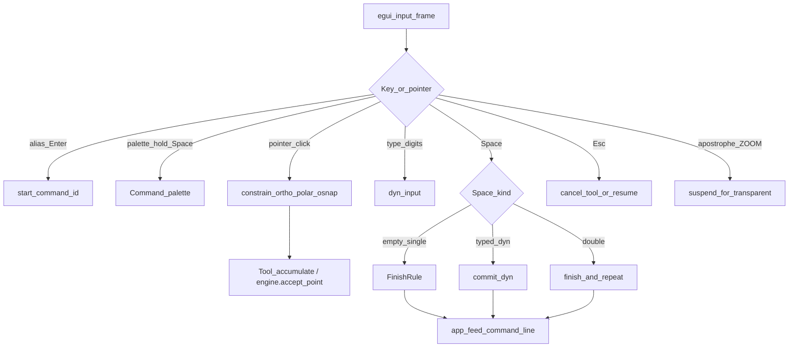
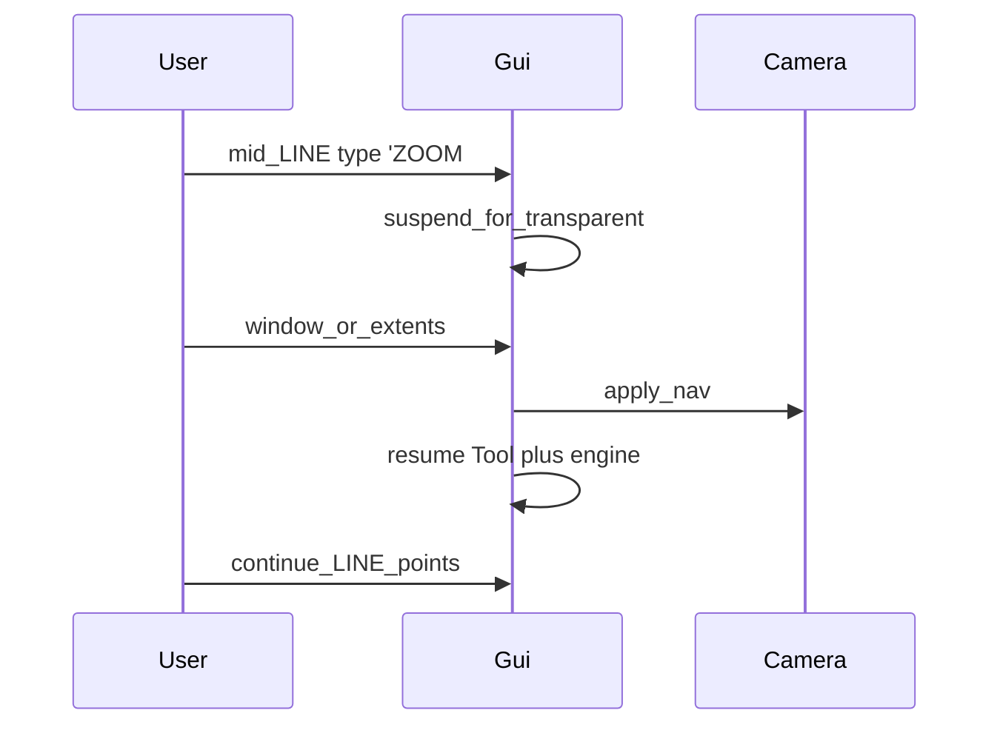

# Volume 3 — Input & Event System

Internal engineering handbook. Daily key tables and per-command steps:
[command-workflows.md](../ux/command-workflows.md).

## Architectural goals

1. **Mouse = position, keyboard = intent, Space = execute.**
2. Dyn input at the crosshair accepts typed values without stealing selection clicks.
3. Noun-verb and verb-noun selection both work for modify tools.
4. Mode toggles (F3/F8/F10/F11) never cancel an in-progress tool.
5. Transparent view commands suspend and resume drafting state.

## Current implementation

### Primary types

| Symbol | Location | Role |
|--------|----------|------|
| `Tool` | `gui.rs` | Interactive tool state machine |
| `EngineState` / `CommandDef` | `command_engine.rs` | Space FSM + step catalog |
| `SpaceGesture` / Space actions | `gui.rs` / engine | Single vs double Space, hold palette |
| `dyn_input`, `dyn_x`/`dyn_y` | `gui.rs` | Typed dynamic input |
| `OsnapState` | `osnap.rs` | Running snap + overrides |
| `UserPrefs` | `prefs.rs` | ortho, osnap, polar, osnap_track, panels |

### Event → command flowchart



### Space semantics

| Input | Action |
|-------|--------|
| Space / Enter / right-click | Accept typed value, next step, or finish |
| Double-Space | Finish open geometry + repeat previous |
| Hold Space / Ctrl+Space | Command palette (recent + fuzzy) |
| Shift+Space | Clear typed dyn input |
| Tab | Cycle dyn X ↔ Y |
| Esc | Cancel tool → Select; clear selection if idle |

Implementation notes:

- Empty Space with no dyn → advance / finish per `FinishRule`.
- Dyn present → `commit_dyn()` then continue.
- Grip edit may cycle `GripMode` on Space instead of finishing.

### Selection modes (input side)

- Click / Shift+click — pick / toggle.
- Drag L→R window / R→L crossing — box select on `Tool::Select`.
- `WP` / `CP` / `FENCE` — `Tool::RegionSelect` (Space closes).
- Verb-noun: empty selection → `StepKind::Selection` before points.
- Noun-verb: preselected set → skip selection step (`tool_for(..., has_selection)`).

### Ortho / polar / snap (input transforms)

Before a point is accepted:

1. Optional orthographic constrain (F8).
2. Optional polar angle constrain (F10, typically 45°).
3. Running osnap (F3) or one-shot override (`END`, `MID`, `PER`, … / Shift+RMB menu).

Details: [Vol 7](./vol-07-osnap-tracking.md).

### Transparent view commands



## Target / planned

- Keep Spacebar-primary contract (BricsCAD §33 capabilities already modeled on
  `CommandDef::capabilities()`).
- True object-snap **tracking** rays (F11) remain a gap — today F11 mainly forces
  osnap+polar prefs.

## Gap analysis

| Topic | Gap |
|-------|-----|
| Apostrophe in scripts | Not suspended in `eval_line` |
| OTRACK | Prefs flag without alignment path geometry |
| Lasso on Select drag | Docs may claim it; Select path is rectangular box |
| Event abstraction | egui-coupled; no separate input crate |

## Data structures

```rust
// command_engine.rs (excerpt)
pub enum StepKind {
    Point { prompt: &'static str },
    NextPoint { prompt: &'static str },
    Distance { prompt: &'static str },
    Thickness { prompt: &'static str },
    Selection { prompt: &'static str },
    Side { prompt: &'static str },
    Text { prompt: &'static str },
    Entity { prompt: &'static str },
}

pub enum FinishRule {
    EmptySpaceAfterMinPoints(usize),
    AutoOnLastStep,
    ExplicitSpace,
}
```

`Capabilities` exposes undo / repeat / preview / snap / dyn input / command-line /
selection-preview for palette tooltips.

## Module layout

```
gui.rs              input loop, Tool, dyn, transparent, app_feed
command_engine.rs   Space FSM, CATALOG, Capabilities
osnap.rs            snap resolve + keywords
prefs.rs            persisted toggles
selection.rs        polygon / fence hit tests
```

## Error handling

- Invalid dyn parse → note / no commit.
- Snap override without required base (PER/TAN) → fail soft with note.
- Transparent refuse if command would edit geometry.

## Performance

- Osnap throttled (~8 ms) in `OsnapState`.
- Repaint only on meaningful pointer motion / active drafting / Space-hold.
- Dyn box is painter-only (non-interactive) so it never steals hits.

## Tests

- Engine finish rules / alias resolve: `command_engine` tests.
- Osnap keywords: `osnap` unit tests.
- Full Space gesture matrix: manual + workflows doc; limited automated GUI coverage.

## Extension points

1. New interactive command → `CommandDef` + `Tool` variant + `tool_for` mapping +
   headless `Command` that accepts the assembled line.
2. New F-key mode → prefs + constrain function in the pick pipeline (don’t fork
   a second pick path).
3. Do not put multi-step prompt state into `aadt-command` unless scripting needs it.

## Related

[Vol 2 Command Engine](./vol-02-command-engine.md) · [Vol 7 Osnap](./vol-07-osnap-tracking.md) ·
[ux/command-workflows.md](../ux/command-workflows.md)
