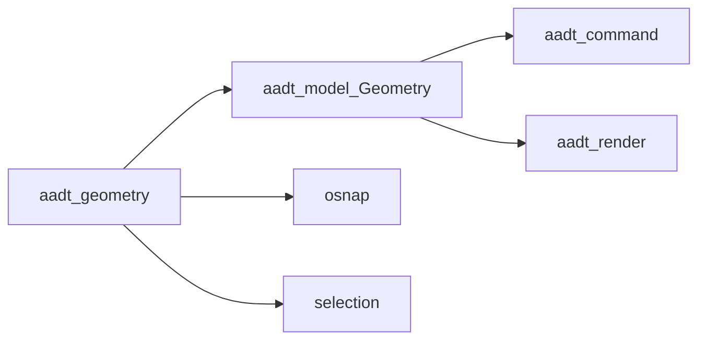

# Volume 4 — Geometry Kernel

Internal engineering handbook. Status: [STATUS.md](./STATUS.md).

## Architectural goals

1. Pure 2D primitives shared by model, detect, render, osnap, and commands.
2. Deterministic floating-point policy via shared epsilons.
3. No UI, I/O, or undo — geometry is value math only.
4. Keep the kernel small; defer splines/solids until Phase 6 is scheduled.

## Current implementation

**Crate:** [`crates/aadt-geometry/src/lib.rs`](../../crates/aadt-geometry/src/lib.rs)

### Tolerances

| Constant | Value | Use |
|----------|-------|-----|
| `LENGTH_EPS` | `1e-6` | Coincident points, zero length |
| `ANGLE_EPS` | `1e-4` | Degree comparisons |

### Public types

| Type | Role |
|------|------|
| `Point2 { x, y }` | `distance`, `coincident`, `midpoint`, `rotate_about`, `scale_about`, `mirror_across` |
| `Vec2 { x, y }` | `length`, `dot`, `cross`, `normalized`, `perp`, `angle_deg` |
| `Segment { a, b }` | Intersection, projection, parallel overlap, foot of perpendicular |
| `Circle { center, radius }` | Area, circumference, line intersections |
| `Arc` | Degrees CCW; `sweep`, `contains_angle`, `to_polyline` |
| `Bbox { min, max }` | `contains_point`, `intersects`, `from_corners` |
| `Polyline { vertices, closed }` | Length, area, centroid, densify bulges, point-in-poly |

Free function: `sample_bulge_arc(a, b, bulge, segments)`.

### Relationship to `aadt-model`

Model `Geometry` wraps kernel types and adds document-level transforms
(`translated`, `rotated`, `scaled`, `mirrored`, `stretched`, `offset`). Offset
geometry is **not** a free function in `aadt-geometry`.

## Target / planned

[AI-native phases](../plans/2026-07-ai-native-phases.md) Phase 6: splines,
meshes, solids. Spatial indexing stays out of this crate (Vol 13 / ShilpiDB).

## Gap analysis

| Topic | Gap |
|-------|-----|
| Spline / ellipse as first-class | Ellipse/spline cmds may approximate; no dedicated kernel types yet |
| 3D | Explicitly out of product scope |
| Spatial index | Deferred by design |

## Data structures

Value types only (`Copy`/`Clone` as appropriate). No arena or handle table in
the geometry crate — entity identity lives in `aadt-model`.

## Traits / interfaces

No trait object surface. Prefer free methods on structs. Commands that need
predicates compose kernel calls inside `Command::run`.

## Module layout

Single-file lib today. Split only when Phase 6 lands heavy modules
(`spline.rs`, `solid.rs`, …).

## Error handling

Kernel prefers `Option` / `bool` over `String` errors. Commands map `None`
(no intersection, degenerate) to user-facing feedback.

## Performance

- Hot in osnap candidate generation, TRIM, detect, selection curve sampling.
- Prefer stack values; avoid allocating polylines in tight loops unless densifying.

## Tests

Inline `#[cfg(test)]` in `aadt-geometry` for intersections, bbox, eps edges,
polyline area/centroid.

## Extension points

1. Add a type only when ≥2 crates need it (don’t put DXF-only quirks here).
2. Keep eps constants centralized — don’t invent local `1e-9` in commands.
3. Document representation ADR before shipping true splines.

## Related

[Vol 1](./vol-01-architecture.md) · [Vol 8](./vol-08-modify-engine.md) ·
[Vol 7](./vol-07-osnap-tracking.md)
