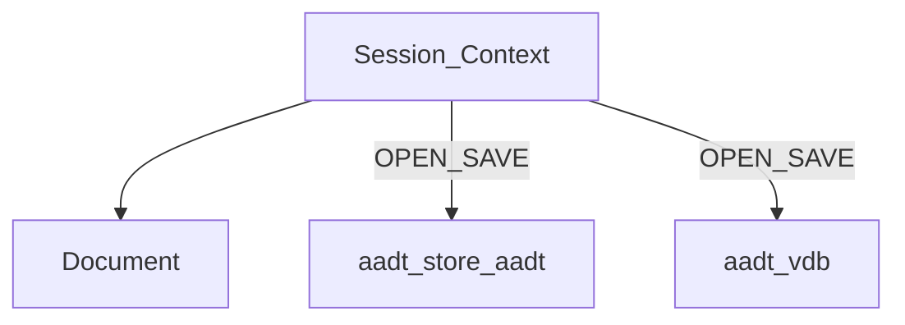

# Volume 5 — Entity Database & ShilpiDB Integration

Internal engineering handbook. **Current vs target diverge** — read both.

## Architectural goals

1. Persist drawings locally (`.aadt`, `.vdb`) without requiring a cloud.
2. Interactive edits stay fast and undoable in process.
3. Floors × model spaces organize disciplines (ADR-0009).
4. Long-term: ShilpiDB as structured SoT with spatial queries (target architecture).

## Current implementation

### Live source of truth

While drafting, **`aadt_model::Document` inside `Session` / `Context` is SoT**.
OPEN/SAVE serialize to disk; undo stacks are RAM-only (Vol 10).



### `Document` tables (summary)

File: [`aadt-model/src/lib.rs`](../../crates/aadt-model/src/lib.rs)

| Field group | Contents |
|-------------|----------|
| Tables | `entities`, `layers`, `blocks`, `hatches`, `dimensions` |
| Spaces | `floors`, `spaces`, `layer_space_map`, `active_space`, trace flags |
| Meta | `properties`, `reference_origin` |
| IDs | `next_id`, `next_floor_id`, `next_space_id` |
| Undo | `open`, `undo_stack`, `redo_stack`, `revision` |

### Entity model

```rust
pub struct Entity {
    pub id: EntityId,
    pub layer: String,
    pub space: ModelSpaceId,
    pub geometry: Geometry,
    pub attributes: HashMap<String, String>,
}

pub enum Geometry {
    Line(Segment),
    Polyline(Polyline),
    Circle(Circle),
    Arc(Arc),
    Text(Text),
    Insert(Insert),
}
```

There is **no** type named `Space` — use `ModelSpace` / `ModelSpaceId`.

### Floors / model spaces ([`floors.rs`](../../crates/aadt-model/src/floors.rs))

| Type | Key fields |
|------|------------|
| `Floor` | `id: LevelId`, `name`, `index`, `elevation_m` |
| `ModelSpace` | `id`, `floor`, `category: SpaceCategory`, `name` |
| `SpaceCategory` | Walls, Structural, Lintel, BeamLayout, Furniture, Custom |

Commands: `FLOOR*`, `CATEGORY`, `CHSPACE`, `LAYERMAP`, `ORIGIN`, `TRACE` — Vol 2.

### Persistence

| Format | Crate | Notes |
|--------|-------|-------|
| `.aadt` | `aadt-store` | SQLite schema; HISTORY checkpoints; takeoff tables |
| `.vdb` | `aadt-vdb` | ShilpiDB; `SpatialGrid`; object/graph hooks; no time-machine |

## Target / planned

[aadt-shilpidb-architecture.md](../architecture/aadt-shilpidb-architecture.md):

- ShilpiDB is SoT; CAD is editor.
- Entity GUID, revision, lock, owner, timestamps on every entity.
- Drawing → Project → Building → Level → Zone → Layer → Entity.
- SpatialGrid updates transactional with every edit.
- Queries: window, crossing, nearest, radius, intersection, containment.

Also ADR-0011 (vector DB), ADR-0008 (history/takeoff), M10 object/graph crates.

## Gap analysis

| Target claim | Current |
|--------------|---------|
| DB SoT while editing | RAM `Document` |
| Entity GUID | Numeric `EntityId` |
| SpatialGrid on every pick | Grid in `.vdb`; GUI pick linear |
| “No monolithic document” | In-process `Document` is monolithic |
| Full spatial query set | bbox + point(+tol) today |

## Data structures — target vs current

| Concern | Current | Target |
|---------|---------|--------|
| Identity | `EntityId(u64)` | GUID |
| Audit | Assist / store layers | Per-entity fields |
| Index | Optional on save to `.vdb` | Always-on transactional |
| Selection state | App/`Context` | Not owned by DB (target also keeps UI out of DB) |

## Module layout

```
aadt-model/     Document, Entity, Floor, ModelSpace, undo
aadt-store/     .aadt open/save, HISTORY
aadt-vdb/       .vdb, SpatialGrid, VdbClient
aadt-object/    typed objects (M10)
aadt-graph/     relations (M10)
```

## Error handling

- I/O failures → OPEN/SAVE command `Err` feedback.
- Schema mismatches → store migration errors (don’t silently truncate).
- Never leave a half-applied `transact` on disk mid-command — disk writes are explicit SAVE.

## Performance

- OPEN time dominated by deserialize + drawlist first build.
- Large `.vdb` index build on save — see Vol 13.
- Interactive path must not round-trip ShilpiDB per mouse move (today it doesn’t).

## Tests

- `aadt-model` floor/space/entity tests.
- `aadt-store` schema / checkpoint tests.
- `aadt-vdb` round-trip + `query_bbox` / `query_point` tests.

## Extension points

1. Entity GUID migration requires an ADR before changing `EntityId`.
2. When wiring SpatialGrid into GUI, keep `Document::transact` as the mutation boundary.
3. Prefer documenting dual-write (RAM + DB) carefully if SoT migration begins — don’t half-migrate.

## Related

[Vol 1](./vol-01-architecture.md) · [Vol 10](./vol-10-undo-transactions.md) ·
[Vol 13](./vol-13-performance-spatial.md) · [ADR-0009](../adr/0009-floors-and-model-spaces.md) ·
[ADR-0011](../adr/0011-vector-database-store.md)
