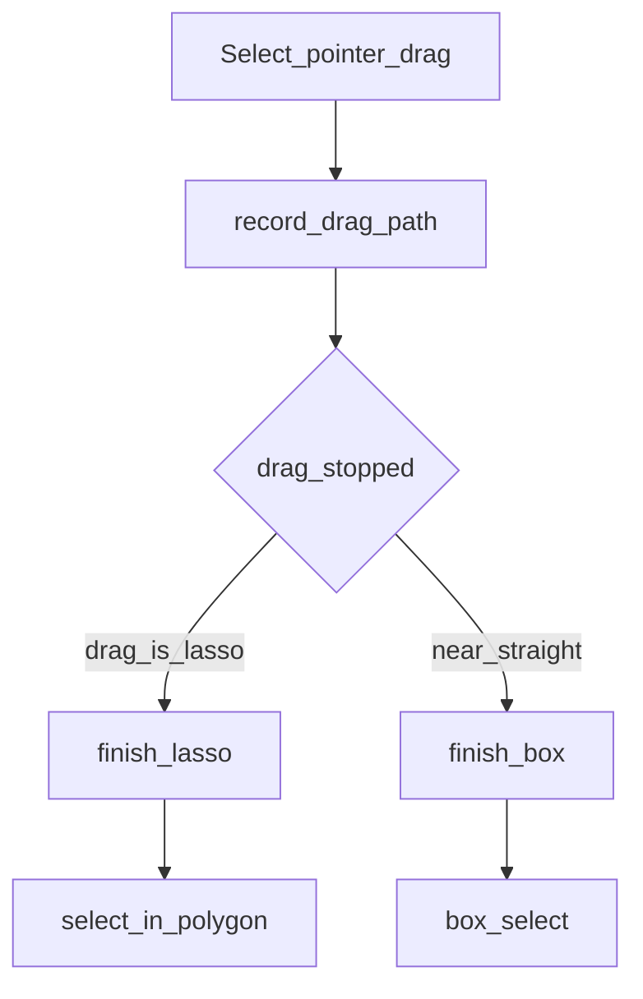

# Volume 6 — Selection Engine

Internal engineering handbook. Status: [STATUS.md](./STATUS.md).

## Architectural goals

1. AutoCAD-like pick, window, crossing, fence, polygon, and free-drag lasso.
2. Headless `SELECT` and GUI tools share the same geometric predicates.
3. Selection feeds modify/draw commands as `EntityId` sets — never mutate in the hit-tester.
4. Hidden / locked layers are skipped.

## Current implementation

### Pure hit tests

**File:** [`crates/aadt-app/src/selection.rs`](../../crates/aadt-app/src/selection.rs)

```rust
pub enum RegionMode { Window, Crossing }

pub fn select_in_polygon(doc: &Document, polygon: &[Point2], mode: RegionMode) -> Vec<EntityId>;
pub fn select_by_fence(doc: &Document, fence: &[Point2]) -> Vec<EntityId>;
pub(crate) fn point_in_polygon(poly: &[Point2], p: Point2) -> bool;
```

Curves sampled at `CURVE_SAMPLES = 32`.

### GUI tools

| Tool / gesture | Behavior |
|----------------|----------|
| Click / Shift+click | Pick / toggle entity, hatch, or dimension |
| Near-straight Select drag | Axis-aligned box; L→R window / R→L crossing |
| **Curved Select drag** | Freehand lasso via `drag_is_lasso` → `finish_lasso` → `select_in_polygon` (+ `dimension_polygon_select`) |
| `WP` / `CP` / `FENCE` | `Tool::RegionSelect` then Space |



Classification (`drag_is_lasso`): path length &lt; 4 → box; chord &lt; 6 px → loop/lasso; else max perpendicular deviation from chord &gt; 12 px → lasso.

Preview: straight → `paint_box`; curved → trail tinted with `canvas::window_edge` / `crossing_edge`.

Headless: `SELECT`, `GROUP`/`UNGROUP`, `QSELECT`, `PSELECT` in `aadt-command`.

### Pick pipeline (today)

Still linear over active space — no SpatialGrid candidate stage (Vol 13).

## Target / planned

```
Mouse → screen → view transform → SpatialGrid query
      → candidates → precise geometry hit → selection
```

## Gap analysis

| Topic | Status |
|-------|--------|
| Free-drag lasso | **Shipped** (restored) |
| SpatialGrid-assisted pick | Open |
| Block insert expansion | GUI paints expanded; rules documented as needed |

## Data structures

- GUI: `selection`, `selected_hatches`, `selected_dimensions`, `drag_path`, `last_selection_window` (box only — cleared on lasso).
- Headless: `Context::selection`, `prev_selection`, `groups`.

## Module layout

```
selection.rs     RegionMode, select_in_polygon, select_by_fence, point_in_polygon
gui.rs           Tool::Select / RegionSelect, finish_box, finish_lasso, drag_is_lasso
aadt-command     SELECT, GROUP, QSELECT, …
```

## Error handling

Empty selection is valid. Degenerate polygons (&lt; 3 points) → no-op at finish.

## Performance

O(n) entity tests × sample density. Target selection &lt; 20 ms needs SpatialGrid (Vol 13).

## Tests

- `selection.rs` region unit tests.
- `gui.rs` `box_select_tests` including `drag_is_lasso` cases (straight / bowed / loop).

## Extension points

1. Insert SpatialGrid **before** precise hit — keep `selection.rs` predicates pure.
2. Optional: test segment-edge crossings for dimension lasso (today point-in only).
3. Don’t put selection mutation inside paint.

## Related

[Vol 3](./vol-03-input-events.md) · [Vol 8](./vol-08-modify-engine.md) ·
[Vol 13](./vol-13-performance-spatial.md) · [STATUS](./STATUS.md)
