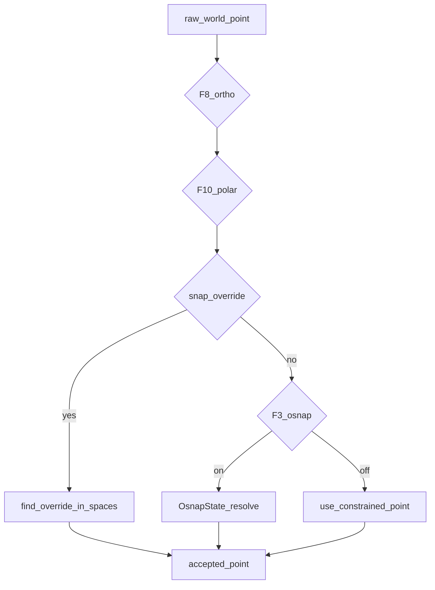

# Volume 7 — Object Snap & Tracking

Internal engineering handbook. Status: [STATUS.md](./STATUS.md).

## Architectural goals

1. Running object snaps during point prompts (AutoCAD muscle memory).
2. One-shot keyword / menu overrides including PER and TAN.
3. Ortho and polar constrain the raw cursor before snap.
4. Tracking (OTRACK) — F11 acquires snaps and snaps to H/V (±polar) paths
   ([ADR-0018](../adr/0018-otrack.md)). Temporary tracking from the live tool
   anchor is still future work.

## Current implementation

**File:** [`crates/aadt-app/src/osnap.rs`](../../crates/aadt-app/src/osnap.rs)

### `SnapKind` (priority earlier → later for ties)

`Endpoint | Intersection | Midpoint | Center | Quadrant | Perpendicular | Tangent | Nearest`

Labels: `END|INT|MID|CEN|QUA|PER|TAN|NEA`.

PER/TAN are **override-oriented** (need a base / drag anchor).

### Resolve API

| API | Role |
|-----|------|
| `OsnapState::resolve*` | Throttled running snap |
| `find_osnap` / `find_osnap_in_spaces` | Free helpers |
| `snap_candidates` / `_into` | Candidate generation |
| `find_override_in_spaces` | Forced kind |
| `parse_snap_keyword` | 3+ letter abbrevs + long forms |
| `perp_feet_on` / `tangent_points_on` | PER/TAN geometry |

### Throttle

`Duration::from_millis(8)` — reuse `last_hit` unless pointer moved beyond tolerance
**or** ≥8 ms elapsed. Target snap &lt; 5 ms is aspirational under linear scan.

### Input integration



- F3 toggles running osnap.
- Shift+RMB / typed `END`… arm one-shot override (Vol 3).
- F11 `osnap_track` enables **true OTRACK** (ADR-0018): dwell-acquire snaps,
  H/V (±polar) rays, snap to path intersections / projections. Esc clears
  acquired points when idle.

## Target / planned

Shipped (L2 / ADR-0018):

1. Acquire points via hover dwell (≥250 ms) while OTRACK is on.
2. Infinite H/V tracking rays from acquired points (±45° when polar on).
3. Snap to ray∩ray and projection onto rays within aperture.

Still future:

- Temporary tracking ray from the live tool anchor.
- Also: SpatialGrid candidates for INT/NEAR (Vol 13).

## Gap analysis

| Feature | Status |
|---------|--------|
| Running END/MID/CEN/QUA/INT/NEA | Done |
| PER/TAN override | Done |
| Keyword + menu | Done |
| True OTRACK paths (acquired) | **Done (L2)** |
| Temporary tracking from tool anchor | Missing |
| F11 semantics | OTRACK on/off (forces osnap) |
| Indexed candidates | Missing |

## Data structures

```rust
pub struct OsnapState {
    // scratch + last_raw, last_at, last_hit for throttle
}
```

GUI holds `snap_hit: Option<(SnapKind, Point2)>` for marker paint
(`theme::canvas::snap()`).

## Module layout

```
osnap.rs          kinds, resolve, override, keywords
otrack.rs         acquire, H/V (±polar) rays, resolve (ADR-0018)
gui.rs            F-keys, menu, paint_snap_marker, paint_otrack, constrain_pick
prefs.rs          osnap, polar, osnap_track
```

## Error handling

- Unknown keyword → not a snap override (falls through to command keyword).
- PER/TAN without base → soft fail + note.
- No candidate within aperture → leave constrained point unsapped.

## Performance

- Throttle 8 ms; still O(entities × samples).
- Plan target: snap &lt; 5 ms — requires indexing + tighter aperture.

## Tests

Unit tests in `osnap.rs` for keywords, PER/TAN, multi-space resolve.
Unit tests in `otrack.rs` for acquire dwell, ray∩ray, polar diagonals.

## Extension points

1. Temporary tracking from the live tool / drag anchor.
2. Candidate stage: `SpatialGrid::query_bbox(aperture)` → existing precise tests.

## Related

[Vol 3](./vol-03-input-events.md) · [Vol 13](./vol-13-performance-spatial.md) ·
[ux/command-workflows.md](../ux/command-workflows.md)
