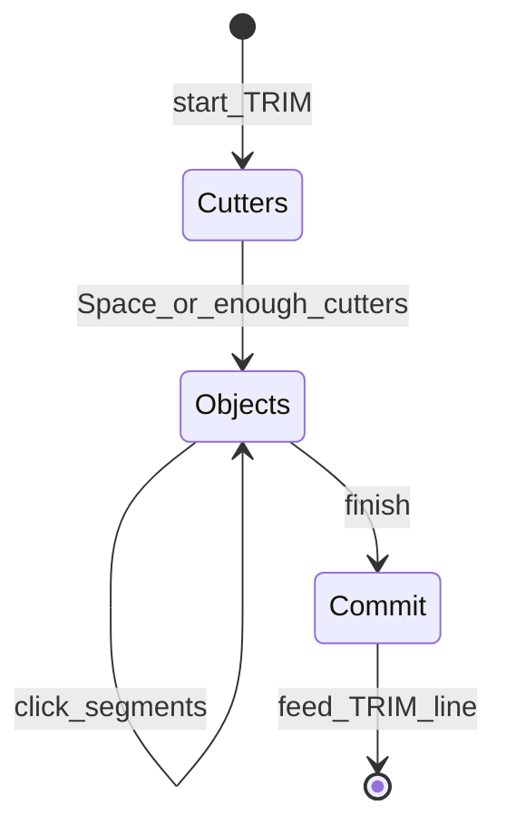
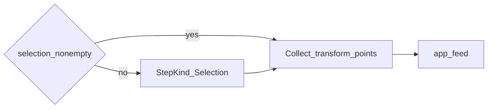

# Volume 8 — Modify Command Engine

Internal engineering handbook. Workflow tables:
[command-workflows.md](../ux/command-workflows.md) (Modify section).

## Architectural goals

1. Modify commands are ordinary `Command::run` implementations — same undo and
   scripting as draw commands.
2. GUI only gathers selection + points; geometry transforms happen inside
   `Document::transact`.
3. Support noun-verb (preselect) and verb-noun (collect selection first).
4. Grips are a first-class modify path (`GRIPEDIT`) that still ends in `feed`.
5. Stay inside the curated modify band — no command-count sprawl.

## Current implementation

### Headless modify commands

Registered in [`aadt-command/src/lib.rs`](../../crates/aadt-command/src/lib.rs)
`builtins` (and some in `essentials.rs`):

| Command | Typical args | Notes |
|---------|--------------|-------|
| MOVE / COPY | selection + base + to | `SELECTION` token or ids |
| STRETCH | crossing window + displacement | |
| ROTATE / SCALE / MIRROR | selection + refs | |
| OFFSET | distance + side | |
| TRIM / EXTEND | cutters + objects | GUI uses phases |
| FILLET / CHAMFER | radius/dist + entities | |
| ARRAYRECT / ARRAYPOLAR / ARRAYPATH | | |
| EXPLODE / ERASE | selection | |
| GRIPEDIT | entity + grip + mode + point | |
| LENGTHEN / BREAK / JOIN / MATCHPROP | essentials pack | |

### GUI `Tool` phases

Interactive modify tools live as `Tool` variants in `gui.rs`. Pattern:

1. Ensure selection (pick phase or preselect).
2. Collect base / second points / keywords.
3. On finish → format command line → `app_feed`.
4. Preview rubber-bands painted from live `Tool` state (no premature `transact`).

TRIM example (conceptual):



### Noun-verb vs verb-noun



`tool_for(token, has_selection)` chooses collecting vs immediate point mode.

### Grips

- Selected entities show grips (canvas selection blue — Vol 9 / theme `canvas::`).
- Grip drag / mode cycle → eventually `GRIPEDIT …` through feed.
- Mid-command vertex undo on polylines may `feed("UNDO")` while keeping `Tool`.

## Target / planned

Modify band is product-locked. Remaining work is polish (preview fidelity,
SpatialGrid-assisted stretch windows — Vol 13), not new command families.

## Gap analysis

| Topic | Gap |
|-------|-----|
| Firm / HCW modify helpers | Often line-only, no `Tool` |
| TRIM freehand | Uses `drag_path`; Select drag is box-only (no lasso) |
| MATCHPROP | essentials; ensure catalog/engine parity when exposing in UI |

## Data structures

- Selection set: GUI `Vec<EntityId>` synced to `Context::selection` before modify feeds.
- Transform previews: ephemeral screen-space geometry in paint path.
- Command args: whitespace tokens; coordinates as decimals in model units.

## Traits / interfaces

Same `Command` trait as Vol 2. Modify cmds typically:

```rust
ctx.doc.transact("MOVE", |d| {
    // read selection, transform geometries, record Ops
    Ok(())
})?;
```

## Module layout

```
aadt-command/src/lib.rs     MOVE COPY TRIM … GRIPEDIT
aadt-command/src/essentials.rs  LENGTHEN BREAK JOIN MATCHPROP
aadt-app/src/gui.rs         Tool phases + previews
aadt-app/src/command_engine.rs  StepKind::Selection for verb-noun
aadt-app/src/selection.rs   region helpers for stretch-like flows
```

## Error handling

- Empty selection when required → error string / note.
- Degenerate transforms (zero scale, coincident mirror line) → refuse with message.
- Partial TRIM misses → feedback listing count.

## Performance

- Transform loops are O(selection). Large arrays → watch ARRAY* growth.
- Stretch/window tests currently linear — SpatialGrid not yet on GUI path.

## Tests

- Headless MOVE/COPY/TRIM/… unit tests in `aadt-command`.
- Selection region unit tests in `selection.rs`.
- Interactive TRIM phases: workflows QA + limited engine tests.

## Extension points

1. New modify command → implement `Command`, register in builtins/essentials,
   optionally add `CommandDef` + `Tool` if interactive.
2. Prefer composing existing transforms over new opcodes when possible.
3. Never mutate `Document` from paint or osnap code paths.

## Related

[Vol 2](./vol-02-command-engine.md) · [Vol 6 Selection](./vol-06-selection-engine.md) ·
[Vol 10 Undo](./vol-10-undo-transactions.md)
