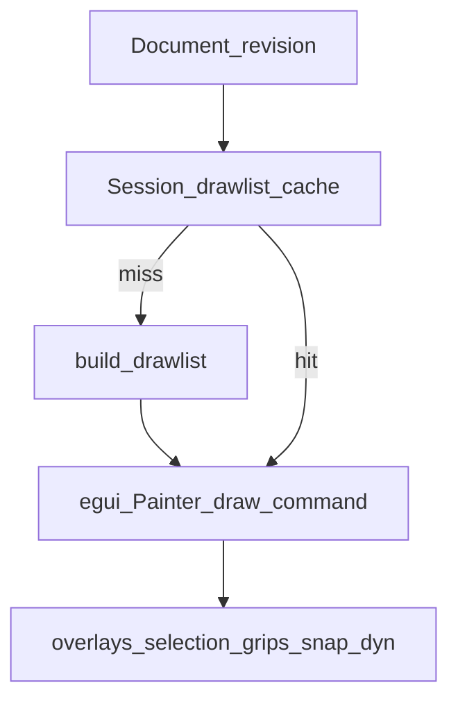

# Volume 9 — Rendering & Viewports

Internal engineering handbook. Status: [STATUS.md](./STATUS.md).

## Architectural goals

1. Deterministic `DrawList` from `Document` (order by entity id / space policy).
2. Interactive paint is a consumer of drawlists + ephemeral overlays.
3. Optional GPU path without changing the command spine.
4. Paper-space multi-viewport CAD is **not** a near-term product goal (stubs only).

## Current implementation

**Crate:** [`crates/aadt-render/src/lib.rs`](../../crates/aadt-render/src/lib.rs)

### Core types

```rust
pub struct Camera {
    pub center: Point2,
    pub scale: f64,           // pixels per world unit
    pub viewport: (f64, f64),
}

pub struct DrawList {
    pub commands: Vec<DrawCommand>,
    pub underlay: Vec<bool>,  // parallel to commands
}

pub enum DrawCommand {
    Polyline { … },
    Circle { … },
    Arc { … },
    Text { … },
    Marker { … },
    Fill { … },
}
```

### Build pipeline

```rust
pub fn build_drawlist(doc: &Document) -> DrawList;
pub fn build_drawlist_with_trace(doc: &Document) -> DrawList; // used for TRACE
```

Pass order (trace-aware): floor below → floor above → same-floor non-active
(underlay) → active space (full).

`Renderer::render(&mut self, camera: &Camera, list: &DrawList)`.

Optional modules: `gpu`, `view` (winit+wgpu), `interact::Interactor`.

### GUI paint path



Overlays use AAD Canvas tokens (`gui_theme::canvas`) — not chrome orange.

### View commands

Headless `ZOOM`/`PAN` set `Context::nav_hint`; GUI applies to `Camera`.
Transparent `'ZOOM`/`'PAN` suspend tools (Vol 2/3).

Stubs: `VP`, `MVIEW`, `UCS`, `PLAN` — refuse / not interactive.

## Target / planned

- Viewport text glyph quality — **✅ L5**.
- Optional wgpu path — **✅ L5.2** ([ADR-0020](../adr/0020-wgpu-canvas-criteria.md)); WinUI remains default shell.
- True layout viewports deferred (ROADMAP lock).

## Gap analysis

| Topic | Gap |
|-------|-----|
| Paper space viewports | Stub only |
| GPU default path | Optional only (ADR-0020); not default shell |
| Viewport TEXT glyphs | **Closed (L5)** |
| PDF open / raster diff | **Closed (L3.3 / ADR-0019)** |

## Module layout

```
aadt-render/src/lib.rs    Camera, DrawList, build_*, Renderer
gpu.rs / view.rs          optional
gui.rs                    paint + overlays + camera control
aadt-pdf / aadt-docs      sheet consumers
```

## Error handling

Missing glyph/font → degrade text; don’t fail `feed`. Underlay flags must stay
parallel to `commands` length.

## Performance

- Cache on `revision`; view cull via `cmd_intersects_view`.
- Target: zoom 60 FPS ([phases plan](../plans/2026-07-ai-native-phases.md)).
- Avoid drawlist rebuild on idle hover (repaint gating in app).

## Tests

`aadt-render` unit tests; `gui.rs` `zoom_tests` / `perf_tests` where present;
recording renderer for deterministic command streams.

## Extension points

1. New geometry → emit new or composed `DrawCommand`s from `build_drawlist`.
2. Keep overlays out of `DrawList` when they are tool-ephemeral.
3. Criteria ADR before switching default shell to wgpu.

## Related

[Vol 1](./vol-01-architecture.md) · [Vol 5](./vol-05-entity-database.md) ·
[Vol 13](./vol-13-performance-spatial.md)
