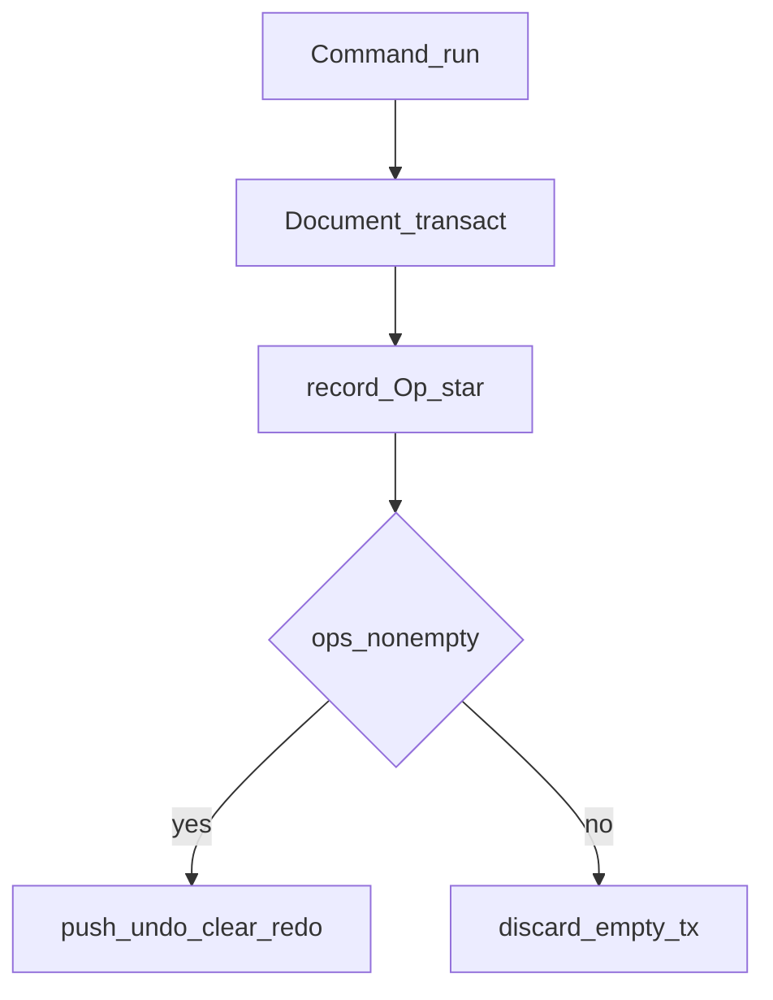
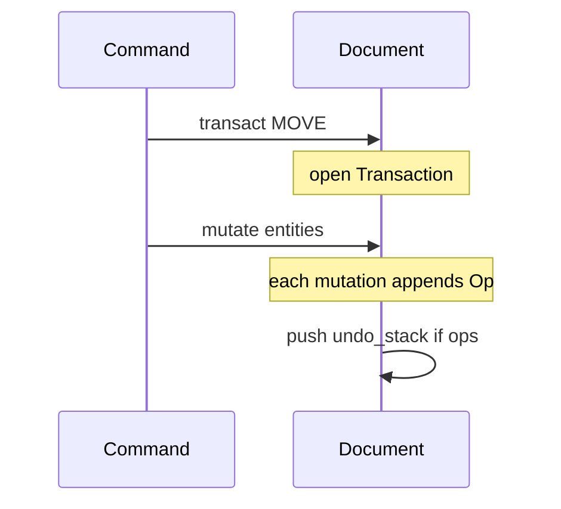

# Volume 10 — Undo/Redo & Transactions

Internal engineering handbook.

## Architectural goals

1. Every interactive edit is one labeled, atomic undo entry.
2. Empty transactions discard (no phantom undo steps).
3. Nested transactions are forbidden.
4. File HISTORY checkpoints are **not** the undo stack.
5. OPEN / bulk `set_document` replace the document without preserving undo.

## Current implementation

### API

From [`aadt-model` `Document`](../../crates/aadt-model/src/lib.rs):

```rust
pub fn transact<R>(
    &mut self,
    label: impl Into<String>,
    f: impl FnOnce(&mut Document) -> R,
) -> R;

pub fn undo(&mut self) -> Option<String>;  // returns label
pub fn redo(&mut self) -> Option<String>;
pub fn can_undo(&self) -> bool;
pub fn can_redo(&self) -> bool;
pub fn undo_label(&self) -> Option<&str>;
pub fn redo_label(&self) -> Option<&str>;
```

### Flow





### Op model

`Op` and `Transaction` are **private** to `aadt-model`. Mutations through
`&mut Document` inside `transact` record invert-able ops (add/replace/remove
geometry, layer changes, etc.). `undo` walks ops in reverse via `invert`;
`redo` re-applies.

### Commands

| Command | Behavior |
|---------|----------|
| UNDO (`U`) | `ctx.doc.undo()` |
| REDO | `ctx.doc.redo()` |

GUI may call `feed("UNDO")` mid-polyline to drop the last committed segment while
keeping the interactive tool alive.

### HISTORY vs undo

| Mechanism | Crate | Scope |
|-----------|-------|-------|
| Undo/redo stacks | `aadt-model` | Current session document |
| HISTORY SAVE/RESTORE | `aadt-store` | Named checkpoints inside `.aadt` |

Restoring a checkpoint replaces document content (treat like a load regarding
session expectations).

## Target / planned

- Keep single-level transactions (no nested txns).
- Richer per-entity revision / audit belongs with ShilpiDB / Assist layers
  (Vol 5 / 11), not a second in-memory undo design.

## Gap analysis

| Topic | Gap |
|-------|-----|
| Nested txn | Debug panic if attempted — no soft nesting |
| OPEN | Clears / replaces undo history |
| Cross-file undo | Not supported |
| Op public API | Ops not exposed for plugins — by design |

## Data structures

```rust
// conceptual — exact Op variants are private
struct Transaction {
    label: String,
    ops: Vec<Op>,
}
// Document holds undo_stack: Vec<Transaction>, redo_stack: Vec<Transaction>
// revision: u64 bumps on commit / undo / redo for drawlist cache
```

## Module layout

```
aadt-model/src/lib.rs     transact, undo, redo, Op, Transaction
aadt-command/src/lib.rs   UndoCmd, RedoCmd
aadt-store                HISTORY checkpoints
aadt-app                  GUI feed("UNDO") mid-command cases
```

## Error handling

- Undo/redo when empty → command reports nothing to undo/redo.
- Nested `transact` → `debug_assert` panic.
- Failed command before successful `transact` → no undo entry.

## Performance

- Op lists grow with edit size; large ARRAY* creates many entities → large undo
  payloads.
- `revision` bump invalidates drawlist cache once per commit/undo/redo.

## Tests

- Model transaction / undo / redo unit tests in `aadt-model`.
- Command-level UNDO after LINE/MOVE in `aadt-command` / app tests.

## Extension points

1. New mutating API on `Document` must record ops inside an open transaction.
2. Do not bypass `transact` from GUI paint code.
3. Checkpointing stays in `aadt-store` — don’t conflate with undo labels.
4. If collaborative edits arrive later, define merge vs undo policy in an ADR
   before changing stacks.

## Related

[Vol 2 Command Engine](./vol-02-command-engine.md) · [Vol 5 Entity DB](./vol-05-entity-database.md) ·
[ADR-0008 history](../adr/0008-drawing-history-takeoff-db.md)
