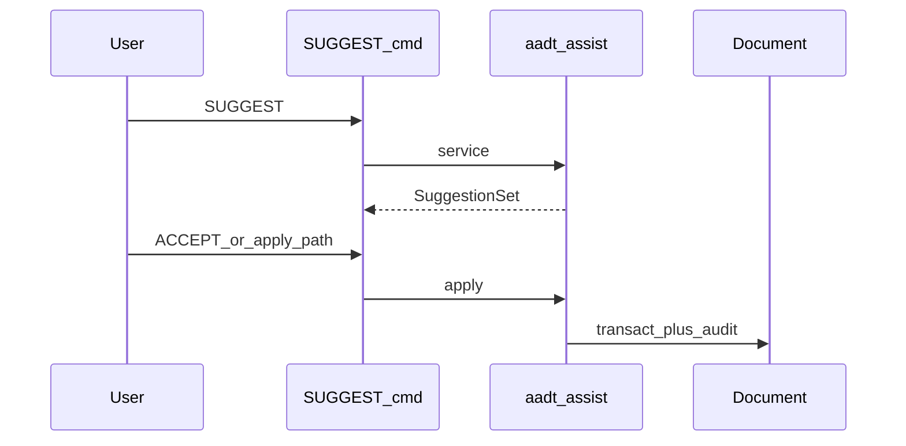

# Volume 11 — AI & Semantic Layer

Internal engineering handbook. Status: [STATUS.md](./STATUS.md).

## Architectural goals

1. Assist **proposes**; only explicit apply commits geometry (ADR-0013).
2. Retrieval (FIND/ASKDOCS) sets selection or answers — does not silent-edit.
3. Objects, graph, embeddings enrich the model for search and takeoff.
4. NL routing produces command strings, not direct `Document` writes.

## Current implementation

### Crate map

| Crate | Role |
|-------|------|
| `aadt-assist` | SUGGEST, CHECK, ASK, COMPARE, RECOMMEND services |
| `aadt-object` / `aadt-graph` | Typed objects + relations (M10) |
| `aadt-embed` / `aadt-vecdb` | Embeddings / corpus |
| `aadt-detect` | Heuristics feeding Assist |
| `aadt-takeoff` | TAKEOFF / BOQ quantities |
| CLI `commands.rs` | Registers Assist/I/O command names on `Registry` |

### Suggest → apply



Key types (`aadt-assist`): `Suggestion`, `SuggestionSet`, `SuggestionKind`,
`SuggestionStatus` (`Pending|Accepted|Rejected`), `Action` (`AddDimension` |
`None`), `apply` / `reject`, `ApplyError`.

`Action::None` suggestions are advisory (checks, narration) and cannot mutate.

NL: `nl::route(phrase) -> Routed` yields a command string for `Session::feed`.

### Registered Assist / intelligence commands (CLI)

`MAPMETA`, `FIND`, `ASKDOCS`, `WITHIN`, `SUGGEST`, `CHECK`, `COMPARE`,
`RECOMMEND`, `ASK`, `TAKEOFF`, `BOQ`, `OBJECTS`, `RELATIONS`, `PERMS`,
`CONNECTOR`, `SITE`, …

## Target / planned

[vision/ai-native-platform.md](../vision/ai-native-platform.md),
[plans/2026-07-ai-native-phases.md](../plans/2026-07-ai-native-phases.md),
ADR-0010/0012/0013/0015/0016. Phase 6 geometry expansion (re-evaluate).

## Gap analysis

| Topic | Notes |
|-------|-------|
| Auto-commit Assist | **Forbidden by design** |
| ANN at 100k+ vectors | Open (search &lt; 100 ms target) |
| Relationship embeddings | Open |
| Graph `Supports` | Needs richer building elements |
| M14 enterprise | **Done** (perms, signed audit, connectors, site ingest) |

## Data structures

Suggestions are serializable records; apply maps `Action` → model mutations
inside one undo transaction. Objects/graph live beside entities (not instead of
`Geometry`).

## Module layout

```
aadt-assist/   dims, rules, compare, details, nl
aadt-object/   aadt-graph/   aadt-embed/   aadt-vecdb/
aadt-cli/src/commands.rs   register()
```

## Error handling

Services return structured errors; commands map to `Feedback::Err`.
`reject` audits without geometry change.

## Performance

Targets: AI suggestion &lt; 2 s; search &lt; 100 ms. Don’t block the GUI thread on
large corpus work without an async boundary (document host policy when adding).

## Tests

`aadt-assist` unit tests with fixture docs; CLI command registration tests;
takeoff tests in `aadt-takeoff`.

## Extension points

1. New Assist capability → service returning `Suggestion` + optional `Action`,
   then a thin `Command` wrapper.
2. Never call `Document` mutators from NL route alone — always `feed` or `apply`.
3. Cite ADR-0013 in PRs that touch commit paths.

## Related

[ADR-0013](../adr/0013-ai-service-layer.md) · [Vol 2](./vol-02-command-engine.md) ·
[Vol 12](./vol-12-plugin-api.md)
