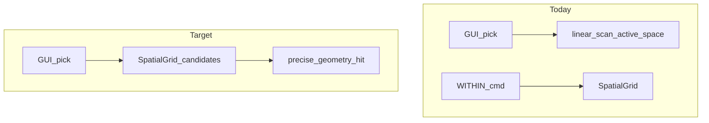

# Volume 13 — Performance & Spatial Indexing

Internal engineering handbook. Status: [STATUS.md](./STATUS.md).

## Architectural goals

1. Hit interactive performance gates without breaking determinism.
2. Use spatial indexes where they reduce O(n) pick/osnap/select cost.
3. Cache drawlists; gate repaints; measure before micro-optimizing.

## Current implementation

### Interactive optimizations

| Mechanism | Where |
|-----------|-------|
| Drawlist cache on `Document::revision` | `Session` |
| Repaint gating (motion / drafting / Space-hold) | `gui.rs` |
| View cull | paint path |
| Osnap 8 ms throttle | `osnap.rs` |

### SpatialGrid (ShilpiDB / `aadt-vdb`)

```rust
// aadt-vdb — conceptual surface
ShilpiDb::query_bbox(rect)
ShilpiDb::query_point(p, tol)
ShilpiDb::entities_within(rect)
build_index(doc) / query_index_bbox(index, rect)
VdbClient::query_bbox / query_point  // remote
```

CLI `WITHIN`, LISP `aadt-within` use the index. **GUI pick/osnap/box_select do not.**



## Target / planned

From [2026-07-ai-native-phases.md](../plans/2026-07-ai-native-phases.md):

| Gate | Target |
|------|--------|
| Open | &lt; 2 s |
| Zoom | 60 FPS |
| Selection | &lt; 20 ms |
| Snap | &lt; 5 ms |
| Search | &lt; 100 ms |
| AI suggestion | &lt; 2 s |

Also: R-tree option; nearest/radius/intersection query APIs; ANN for 100k+ vectors;
M9.9 frame-time telemetry as harness.

## Gap analysis

| Topic | Gap |
|-------|-----|
| Grid on GUI pick/osnap | Not wired |
| nearest / radius / intersection | Missing |
| R-tree | Missing |
| Perf CI gates | Not fully automated |
| Architecture diagrams implying grid-on-pick | Aspirational |

## Data structures

Uniform grid from `shilpidb::SpatialGrid` (re-exported by `aadt-vdb`). Index
lifecycle today tied to `.vdb` save/load more than per-`transact` GUI updates.

## Module layout

```
aadt-vdb/     SpatialGrid, ShilpiDb, VdbClient
gui.rs        pick_entity, box_select, osnap consumers
aadt-render   cull / cache consumers
aadt-app      perf_tests / HUD (F7)
```

## Error handling

Index rebuild failure on SAVE must not corrupt RAM `Document`. Query miss → empty
set, not error.

## Performance (engineering practice)

1. Measure with F7 HUD / benches before claiming a gate.
2. Prefer algorithmic fix (index) over paint micro-tweaks.
3. ARRAY* / Assist corpus can dominate — profile those separately.

## Tests

`aadt-vdb` query tests; `gui.rs` `perf_tests` where present; add hermetic benches
per phase when gates become CI-blocking.

## Extension points

1. Spec: aperture bbox → `query_bbox` → existing precise hit (pick & osnap).
2. Decide: rebuild index every `transact` vs dirty regions vs save-only.
3. Document hardware assumptions when publishing gate numbers.

## Related

[Vol 5](./vol-05-entity-database.md) · [Vol 6](./vol-06-selection-engine.md) ·
[Vol 7](./vol-07-osnap-tracking.md) · [Vol 9](./vol-09-rendering.md)
